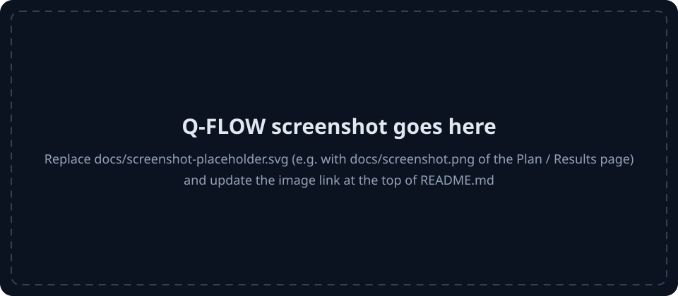
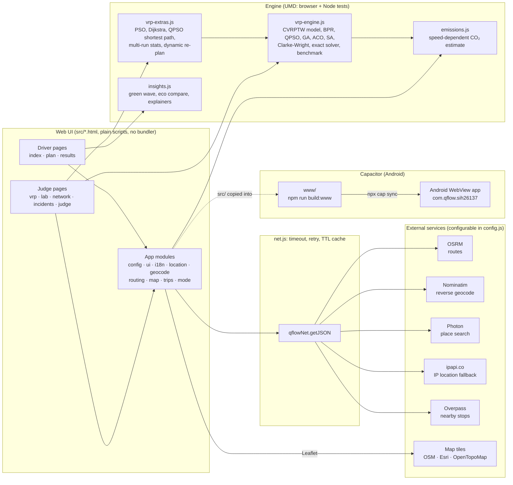

# Q-FLOW v3 (SIH26137)

Q-FLOW is a route-planning app with two faces. Drivers get a simple trip planner: search a destination, compare up to three real road routes by time, signals and estimated CO₂, and get plain-language advice. Judges and researchers get a fleet-routing lab: a capacitated vehicle routing problem with time windows (CVRPTW) on a congestion-aware road model, solved by a quantum-inspired particle swarm (QPSO) and benchmarked honestly against GA, ACO, simulated annealing, classical PSO, Clarke-Wright and an exhaustive solver.

QPSO here is **quantum-inspired**: it is a classical algorithm that runs on ordinary classical hardware (your CPU or phone), and no quantum computer is used anywhere in Q-FLOW.

*Screenshot placeholder: replace `docs/screenshot-placeholder.svg` with a real capture of the Plan or Results page.*

**Two views in one app** (switch with the button in the top bar):

- **Driver view (default):** plain words, big buttons, first-time tips, saved places (Home/Work/College), voice search, heavy-traffic alert, a big Start-trip screen and a clear offline message.
- **Judge view:** Judge Hub, Fleet VRP, Research Lab, and all technical panels and exports.

It runs as a website (`npm run web`) and as an Android app via Capacitor.

**Contents:** [Architecture](#architecture) · [The optimisation model](#the-optimisation-model) · [Simulated traffic](#how-simulated-traffic-works) · [Live traffic](#live-traffic-tomtom) · [Navigation](#turn-by-turn-navigation-real-gps) · [Results](#results) · [Real vs simulated](#what-is-real-and-what-is-simulated) · [Setup and commands](#setup-and-commands) · [Tests](#tests) · [External services](#external-services) · [Android](#android) · [Limitations](#limitations) · [Troubleshooting](#troubleshooting) · [Notes](#notes)

There is **no backend server**: everything (optimisation included) runs in the browser or the Android WebView, and the only network calls are to the public map services listed under [External services](#external-services). An audit of the issues found and fixed is in [docs/AUDIT.md](docs/AUDIT.md).

## Architecture

The browser modules are plain `<script>` files that share global names, so their order matters: `safe-html.js`, `net.js`, `emissions.js`, `config.js`, `ui.js`, `i18n.js`, `location.js`, `geocode.js`, `routing.js`, `traffic-live.js`, `swarm-sim.js`, `map.js`, `trips.js` (with the optional `local-config.js` before `config.js`), then page scripts (`mode.js`, `insights.js`, `vrp-engine.js`, `vrp-extras.js`). `test/test_modules.js` checks this order on every page.

| File | Concern |
|---|---|
| `safe-html.js` | `escapeHtml()` for anything inserted as HTML (UMD) |
| `net.js` | fetch helper: timeout, retry, cache (UMD) |
| `emissions.js` | CO₂ estimate: speed-dependent g/km curve, the one place it is parameterised (UMD) |
| `config.js` | `QFLOW_CONFIG` endpoints and settings, status bar, shared network client |
| `ui.js` | background canvas, sound effects, toasts, theme and navigation chrome |
| `i18n.js` | UI strings and language switching |
| `location.js` | location permission rationale, geolocation, IP-lookup fallback |
| `geocode.js` | reverse geocoding (Nominatim) and place autocomplete (Photon) |
| `routing.js` | vehicle profiles, OSRM routing, route tags and preference scoring |
| `traffic-live.js` | optional TomTom live traffic: key handling, flow tiles, incidents, live route times, fleet matrix (UMD) |
| `local-config.js` | optional local settings loaded before `config.js`; `build:www` writes the TomTom key here from `QFLOW_TOMTOM_KEY` (never put keys in `src/`) |
| `nav-location.js` | LocationService: continuous device GPS (watch), accuracy, heading, permission and signal-loss states, background/foreground (UMD) |
| `nav-routing.js` | RoutingService: provider-independent road routes (TomTom with guidance, OSRM fallback) normalised to one NavRoute format (UMD) |
| `nav-progress.js` | RouteProgressService: snapping, remaining distance/time, next maneuver, off-route detection, arrival, voice planning, bearing filter (UMD) |
| `nav-camera.js` | NavigationCameraController: follow / free modes, heading-up rotation, speed-based zoom, gestures, re-centre (UMD) |
| `nav-controller.js` | NavigationController: navigation state, start/stop, reroute from the latest GPS fix, arrival (UMD) |
| `nav-device.js` | voice output and keep-screen-on (native QFlowNative plugin in the app; Web Speech / Wake Lock in browsers) |
| `swarm-sim.js` | small 2D particle-swarm simulation (UMD; currently not used by a page) |
| `map.js` | Leaflet map builder and controls |
| `trips.js` | trip history, leave-by time, GPX / GeoJSON export |
| `vrp-engine.js`, `vrp-extras.js` | the optimisation engine (UMD, also used by the tests and the benchmark) |
| `insights.js` | driver insights: green-wave speed, eco comparison, route-change explanations (UMD) |

### UI: responsive, layered themes

All styling is in `src/style.css` (plus small page-level `<style>` blocks), built from theme tokens:

- **Layers:** each theme has a soft page background, slightly different secondary areas, cards, raised menus/popovers and a separate input shade, plus subtle dividers, softer component borders and 3:1 control borders. Dark uses charcoal greys (lighter surfaces show elevation); light uses an off-white page with white cards and soft shadows. Nothing is pure black or pure white.
- **Text:** primary text is comfortable rather than maximal (about 11-14:1), with secondary, tertiary and disabled shades; secondary text stays at or above 4.5:1.
- **Accent:** one accent colour (default blue) for primary buttons, links, active/selected states, focus rings, progress and the highlighted route/algorithm. Status colours (success, warning, danger) are used sparingly for congestion, alerts and real/simulated tags. Lines and charts also keep dash patterns, so they read without colour.
- **Appearance menu:** the Theme button in the top bar opens a panel with System / Light / Dark and seven accent colours (blue, teal, green, violet, amber, rose, graphite). Choices are saved in `localStorage` (`qflowTheme`, `qflowAccent`); "System" follows the device setting live. A tiny script in each page's `<head>` applies both before first paint, and changes fire a `qflow:themechange` event so charts redraw.
- **Full-screen map:** on every page with a map (Home, Plan, Results, Fleet VRP, Road Status), the map fills the screen under the top bar, like a phone maps app. All the page's other blocks, unchanged and in order, sit in a panel docked at the bottom. Tap the panel's handle to switch between half and full height, or drag it (it snaps to small, half or full). The map's ⤢ button also expands the panel. Cards in the panel use as many columns as fit the screen. Map controls, the legend and route fitting stay above the panel. This is done by `qflowFullMapLayout` in `src/map.js`, which moves the existing elements rather than copying them, so ids and page scripts are unaffected; `test/test_fullmap.js` covers it.
- **Breakpoints:** the nav collapses into a menu at 1180 px (or earlier if the labels do not fit, e.g. in another language); two-column page layouts with a sticky, full-height map from 1024 px; stacked layouts with 2-column card grids on tablets; single-column layouts on phones, down to 320 px; a separate layout for short landscape screens. Touch targets are at least 44 px on touch screens.
- `test/test_theme.js` checks the palette (distinct surface layers, comfortable and accessible contrast for every theme and accent, colours only from tokens, no gradients or web fonts), that every map line has a theme class (Leaflet's default is blue), and the System / Light / Dark and accent behaviour.

## The optimisation model

### Road network and BPR congestion

For the fleet problem, nodes are a depot (0) and customers 1..n. Road distance is the straight-line distance times a detour factor, and travel time follows the Bureau of Public Roads (BPR) volume-delay function:

$$d_{ij} = 1.28 \cdot \text{haversine}(i, j), \qquad t^0_{ij} = \frac{d_{ij}}{\bar v}\cdot 60, \qquad t_{ij} = t^0_{ij}\left(1 + \alpha \left(\frac{V}{C}\right)^{\beta}\right) + \delta_{ij}$$

with base speed $\bar v = 40$ km/h, $\alpha = 0.15$, $\beta = 4$, $V/C$ the simulated traffic level (volume over capacity; see [How simulated traffic works](#how-simulated-traffic-works)), and $\delta_{ij}$ an optional incident delay in minutes (`computeCongestedTime` and `buildCostMatrix` in `src/vrp-engine.js`). At $V/C = 1$ trips take 15% longer than free flow; at $V/C = 1.9$ about 2.95 times as long.

### CVRPTW objective

Each customer $i$ has demand $q_i$, a time window $[e_i, l_i]$ and a service time $s_i$; each of the $K$ vehicles has capacity $Q$. A solution is a set of routes $r_1..r_m$ starting and ending at the depot at time 0. On a route, arrival at customer $i$ is $a_i$; a vehicle that arrives early waits until $e_i$, then serves for $s_i$. The cost minimised by every algorithm is

$$F = \underbrace{\sum_{k} D_k}_{\text{distance (km)}} + \underbrace{0.4 \sum_{k} T_k}_{\text{route time (min)}} + \underbrace{1500 \sum_{k} \max(0,\ L_k - Q)}_{\text{capacity overload (kg)}} + \underbrace{20 \sum_{i} \max(0,\ a_i - l_i)}_{\text{lateness (min)}} + \underbrace{10000 \cdot \max(0,\ m - K)}_{\text{extra vehicles}}$$

where $D_k$ is the road distance of route $k$, $T_k$ its completion time back at the depot (driving, waiting and service), and $L_k = \sum_{i \in r_k} q_i$ its load. Capacity, time windows and fleet size are soft constraints handled by these fixed penalty weights (`evaluateTourSequence`). Overload is counted on every route, and returning to the depot after its closing time $l_0$ counts as lateness. Every result carries `feasible` and `violations` (`capacityKg`, `lateMin`, `extraVehicles`); the Fleet VRP page marks infeasible plans with an "Infeasible" badge and explains why (for example, a stop heavier than one vehicle, or more demand than the fleet can carry), and the benchmark reports each algorithm's feasible-run rate.

Inputs are validated before solving (`validateInstance`): a depot is required; at most 200 customers (the map allows 60 pins); coordinates, demands, time windows, capacity, fleet size and traffic must be finite and in range. Bad input raises a `QFlowInputError` with a `code` and `field` that the pages show as a plain message instead of crashing. Dynamic re-planning (`dynamicReplan`) warm-starts QPSO from the current plan, so a re-plan is never worse than keeping the old plan under the new conditions.

The metaheuristics search over customer orders. An order is split into routes greedily: a new vehicle starts when the next customer would exceed capacity, unless the fleet is used up (then the last vehicle is overloaded and penalised). QPSO and PSO encode an order as random keys (one number per customer, sorted). Clarke-Wright builds its own routes and is scored on them with the same $F$. The exact solver enumerates every customer order ($n!$, up to 9 customers) and cuts each one into at most $K$ routes with the optimal split decoder. That makes it the true optimum of the objective for at most $K$ vehicles. QPSO also uses the optimal split decoder (`splitTourSequence`); the other metaheuristics use the greedy split described above.

QPSO uses the Sun, Feng & Xu (2004) update, $p = \varphi\, p_{best} + (1-\varphi)\, g_{best}$, $x \leftarrow p \pm \alpha\, |m_{best} - x| \ln(1/u)$ with $\alpha$ from 0.95 to 0.50, plus heuristic seeding and a Lamarckian 2-opt / or-opt local search (details in `src/vrp-engine.js` and [BENCHMARK.md](BENCHMARK.md)).

CO₂ on routes and in the fleet table is an estimate from `src/emissions.js` (see [Notes](#notes)); it is reported, not optimised.

## How simulated traffic works

**Without a TomTom API key, all traffic in Q-FLOW is simulated.** No traffic provider, sensor feed, incident feed or road-closure feed is used, and driver routes come from OSRM, whose durations are typical road speeds. With a key, see [Live traffic (TomTom)](#live-traffic-tomtom).

For the fleet problem, `buildCostMatrix(nodes, trafficLevel, incidents, { timeOfDayMin, segmentVariation, seed })` sets the V/C ratio of each road segment $ij$ as

$$\left(\frac{V}{C}\right)_{ij} = \text{clamp}_{[0,3]}\Big(\text{level} \cdot f(\text{time}) \cdot \big(1 + \sigma\,(2 u_{ij} - 1)\big)\Big)$$

- **level** is the Traffic slider on the Fleet VRP page.
- **f(time)** is a fixed time-of-day profile, `trafficProfile`. It is 0.55 off-peak, with Gaussian bumps peaking at about 1.15 at 09:00 and about 1.25 at 18:30. Choosing "Flat" (the default) sets f = 1.
- **σ** is the per-road variation: 0 when off, 0.4 when "Vary congestion by road" is ticked.
- **u_ij** is a seeded, symmetric hash of the segment pair (`segmentNoise`). The same seed always gives the same "busy" and "quiet" roads.
- **Incident delays** δ_ij are added on top, in minutes.

Called with no options, the matrix is identical to the original single-multiplier model, so the benchmark is unaffected. The matrix returns a `traffic` object with `source: 'simulated'` and the parameters used. The page shows this as "SIMULATED TRAFFIC · STRAIGHT-LINE DISTANCES".

Road Status, Road Alert Scenarios and the "Simulate traffic change" button on Results are scripted demos and are labelled as simulated.

## Live traffic (TomTom)

Live traffic is **optional**. It's used only when a TomTom API key is configured. Without one, or whenever TomTom fails, the app keeps the simulated traffic and its "simulated" labels. A label switches to "live" only after live data has actually arrived; for the map colours, that means after the first traffic tile has loaded.

| What | Without a key | With a TomTom key |
|---|---|---|
| Base map style | OpenStreetMap standard style, full colour (darkened in the dark theme) | TomTom's map style (day or night to match the theme), like a phone navigation map. If the key lacks the Map Display API, it falls back to OpenStreetMap. |
| Road colours on every map | Example corridors (home) or none | TomTom live flow tiles: green (free flow) → yellow/orange (slow) → red (jam) → dark red (closed). There's a "Traffic" on/off button in the map's layer box. |
| Incidents | Scripted scenarios | Real accidents, jams, closures and road works near you (TomTom Incident Details), on the Home map, the Road Status list and the Road Alerts page. The scenario cards stay simulated. |
| Driver route times (Plan, Results) | OSRM typical speeds | TomTom live travel time along each OSRM route (start, two points on the route, end). The card shows "+N min traffic (live)". If any route has no live time, all routes keep OSRM times, so they're always compared on the same basis. |
| Heavy-traffic alert | A labelled prediction | The measured live delay on your route. No invented location or clear-by time. |
| Fleet VRP | Simulated BPR, straight-line × 1.28 | Tick "Use live traffic (TomTom)". It uses TomTom Matrix Routing with live traffic: real road distances and current travel times between all stops, up to 15 stops. |

**Get a key:** create a free account at developer.tomtom.com and copy the API key it gives you.

**Use the key on one device:** open **Theme (Appearance) > Live traffic (TomTom)**, paste the key, then press Save. The page reloads with live traffic. The same panel can pause live traffic or remove the key. The key is stored in this browser or app only.

**Build the key into the app, e.g. an APK for friends:** set the key as an environment variable when building. In PowerShell:

    $env:QFLOW_TOMTOM_KEY = "your-key"
    npm run android:apk

Alternatively, save the key once in a file named `.tomtom-key` in the project folder, containing just the key. The file is git-ignored. `npm run build:www`, `npm run android:apk` and `npm run tomtom:check` then use it automatically, and `QFLOW_SERVE=www npm run web` serves the built app with the key. `build:www` writes the key into `www/local-config.js` only. The key is never stored in `src/`, and `www/` is git-ignored. Anyone with the APK can extract the key, so use a key for this app only. Its free quota is all that's at stake; set usage limits in the TomTom dashboard if offered. Don't commit keys, and don't put them in `src/local-config.js`.

**Quota:** TomTom's free tier allows 50,000 tile requests and 2,500 other requests per day. Map traffic colours use tile requests. Incident lists, route times (one per route) and the Fleet VRP matrix use the other kind. The matrix is sent in blocks of at most 100 stop pairs: 1 request for up to 10 points, 4 for 11–16. These limits are from TomTom's documentation at the time of writing, so check developer.tomtom.com/pricing. Live answers are cached briefly: 2 minutes for incidents and route times, 5 minutes for the fleet matrix. If the key is rejected (HTTP 401/403) or the daily limit is reached (429), the app shows a message and falls back to simulated traffic.

**Privacy:** with live traffic on, the map area you view, your route (start, destination and two points along it), and the Fleet VRP stops are sent to TomTom. Without a key, nothing is sent to TomTom.

**Verification:** the request and response handling is tested with mocked responses (`test/test_live_traffic.js`, `test/test_vrp_live.js`). On 2 October 2026 it was also checked against the real TomTom service with `npm run tomtom:check`, near Hyderabad: flow tile, 154 incidents parsed, live route time, and a 3 × 3 live matrix all OK. Run `npm run tomtom:check` with your own key (from `QFLOW_TOMTOM_KEY` or a git-ignored `.tomtom-key` file) to confirm it covers every API Q-FLOW uses. The pages' live display still needs a check by eye.

## Turn-by-turn navigation (real GPS)

"Start trip" on the Results page opens real navigation, driven by the device's actual GPS position. The old simulator, a marker moved along the route on a timer with an invented speed, has been removed.

**Flow:**

1. You pick a destination on Plan by searching for a place or tapping the map. Results shows a road-route preview.
2. You press **Start**. After the location explanation, the app starts a continuous high-accuracy GPS watch.
3. The first good fix (±100 m or better, or the best fix after 8 s) becomes the start of the route. The previewed route is reused only if that real position is on it (within 60 m). Otherwise the route is calculated from the GPS position to the destination.
4. Every new fix updates the position marker (arrow plus accuracy circle) and the camera. It also updates the next maneuver and its distance, the remaining distance and time, the arrival clock, the current road, speed and GPS accuracy, and the spoken instructions.
5. When you leave the route, it's recalculated from your latest position to the same destination. Navigation continues without a restart.
6. Arrival is detected within 20–50 m of the destination, depending on GPS accuracy. GPS updates then stop, and "New trip" is offered.

**Architecture:**

    LocationService (nav-location.js)        device GPS -> { lat, lng, accuracy, heading, speed, timestamp }
            ↓
    NavigationController (nav-controller.js) validation -> bearing -> progress -> off-route -> reroute -> arrival
            ↓
    RoutingService (nav-routing.js)          getRoute(origin, destination, { headingDeg, via, travelMode })
            ↓                                  TomTom (traffic + guidance) -> OSRM fallback
    RouteProgressService (nav-progress.js)   remaining distance/time, next maneuver, current road, arrival
            ↓
    NavigationCameraController (nav-camera.js) follow / free mode, heading-up rotation, zoom
            ↓
    Map UI (results.html)

To add another provider (Google, Mapbox, HERE, GraphHopper, Valhalla), write `{ name, available(), getRoutes(origin, dest, options) }` returning NavRoutes. Then add it to the list in `qflowRoutingService` at the bottom of `nav-routing.js`.

**How the hard parts are handled:**

- **Direction of travel:** the GPS course is used when moving at 2 m/s or more. Otherwise the app uses the bearing between fixes after 10 m of movement, or the road direction at your snapped position. The device compass is used only when standing still. Each source is smoothed on the circle, with a dead band (2–6°) and a rotation-rate limit (90°/s), so the map doesn't shake. The position arrow shows that bearing.
- **Off-route detection:** a fix counts as "away" beyond max(40 m, accuracy + 20 m), capped at 120 m. You're off route only after 3 consecutive away fixes spanning at least 4 s. Fixes worse than ±80 m don't count either way. Reroutes are at least 10 s apart. If one fails, the old route is kept and it retries 15 s later. Stops already passed are not routed through again.
- **Fix validation:** fixes that are stale, invalid, or imply over 70 m/s are discarded.
- **Camera:** in follow mode, the map rotates to your direction of travel. You sit in the lower part of the screen, so the road ahead is visible. Zoom follows your speed (17 / 16 / 15.5 / 15) and changes only after 4 s at the new speed. Movement is eased, not snapped. Any pan, pinch, two-finger rotate or scroll switches to free mode, and **◎ Re-centre** returns to follow mode. The compass button switches between heading-up and north-up. Leaflet can't rotate maps, so the map sits in a rotated square layer and `nav-camera.js` handles the gestures itself.
- **Voice:** each maneuver is announced at most once per stage:
  - far: about 500 m, or 1 km above 72 km/h;
  - near: about 7 s ahead, at least 100 m;
  - now: about 2.5 s ahead.

  The app also says "Continue for N km" on long stretches, plus "Rerouting" and "You have arrived". The 🔊 button turns voice off; the setting is `qflowNavVoice`. In the Android app, speech uses Android's text-to-speech through Q-FLOW's small native plugin (`QFlowNative`, `android/app/src/main/java/com/qflow/sih26137/QFlowNativePlugin.java`), because Android's in-app browser has no Web Speech. In browsers, it uses `speechSynthesis` when voices are available.
- **Lifecycle and errors:** the status line explains each problem in plain language:
  - permission denied, or blocked in settings: the app explains how to allow it;
  - Location (GPS) turned off;
  - weak accuracy, or only approximate location allowed: it asks for "Precise location";
  - signal lost: a watchdog restarts the GPS watch after 15 s without fixes;
  - in the background: paused, and resumed on return;
  - insecure page or no GPS available.

  The screen is kept on during navigation (`FLAG_KEEP_SCREEN_ON` in the app, the Screen Wake Lock in browsers).

**Permissions:** only `ACCESS_FINE_LOCATION` and `ACCESS_COARSE_LOCATION`, requested when navigation needs them. A `<queries>` entry for the text-to-speech service is also added; Android 11+ needs it to find the TTS engine. **No background location:** navigation runs with the screen on, so it isn't needed. Adding it would mean `ACCESS_BACKGROUND_LOCATION`, a location foreground service with `FOREGROUND_SERVICE_LOCATION`, a permanent notification and a Play Store declaration. If you refuse location, you can still view routes and steps.

### Keys and services for navigation

| Service | Key | Where to create it / what to enable | Where the key goes | Free tier and limits |
|---|---|---|---|---|
| **TomTom Routing API** (preferred: traffic-aware routes with turn-by-turn guidance) | The same TomTom key as live traffic | developer.tomtom.com > Dashboard > Keys. The key must include **Routing API**, and **Traffic API** for traffic colours. | `.tomtom-key` file (git-ignored) or `QFLOW_TOMTOM_KEY` at build time, or Appearance > Live traffic on the device. Never in `src/`. | Free, no card: 2,500 non-tile requests per day. Each route or reroute is 1 request. Over the limit you get HTTP 429 and the app falls back to OSRM. |
| **OSRM** (fallback, and the only provider without a key) | None | Public demo server `router.project-osrm.org` | `osrmBaseUrl` in `src/config.js` | Free, but **demo only**: about 1 request per second, no SLA. For real use, run your own OSRM, or use TomTom. |
| **Photon / Nominatim** (place search, addresses) | None | Public servers | `photonBaseUrl`, `nominatimBaseUrl` | Fair use; Nominatim allows at most 1 request per second. |
| **OpenStreetMap tiles** | None | Public tile server | `tiles.streets` | No heavy use; attribution required. |

**Restricting the TomTom key:** an app key can't be truly secret, because anyone with the APK can extract it. Use a key made just for Q-FLOW with only the products above enabled. Apply any domain or app restrictions and usage limits the TomTom dashboard offers. Watch the usage page, and replace the key if it leaks. For production, put routing behind your own server, which keeps the key server-side. **Billing:** not needed for the free tier. Usage over the daily limit is blocked, not charged, unless you add prepaid credit.

`npm run tomtom:check` (6 checks) also confirms the key can load TomTom map tiles (Map Display API) and returns navigation routes with turn-by-turn guidance. Verified against the real service on 2 October 2026, near Hyderabad: 6 of 6 checks OK. The map tile and flow tile loaded, 253 incidents were parsed, the live route took 23.4 min including 6.3 min of traffic, and a 5.9 km navigation route came back with 15 turn-by-turn steps. A 3 × 3 live matrix also worked.

### Testing navigation

The automated tests feed recorded-style GPS traces through a mock that exists only in `test/`:

- `test/test_navigation.js`: routing, progress, off-route, reroute, arrival, voice and bearing;
- `test/test_nav_location.js`: permissions and GPS states;
- `test/test_nav_page.js`: the real Results page script, end to end.

The app itself never uses simulated positions. On a phone:

1. Install the APK and allow **Precise** location.
2. Plan a short trip and press **Start**. Check that the arrow is at your real position.
3. Walk or drive. The arrow, ETA and next turn should update, and the map should turn with you.
4. Pan the map. It should stop following, and ◎ Re-centre should bring it back.
5. Take a different road. Within about 5–10 s you should hear "Rerouting", and a new route should start from where you are.
6. Reach the destination. "You have arrived" should appear.

## Results

Generated by `npm run bench` from a seeded run on held-out instances (QPSO was tuned on different seeds). Every metaheuristic gets the same number of objective evaluations and 10 independent seeded runs per instance; "Gap, mean ± std" pools all runs on all instances. The **Outcome** lines are computed from the numbers by the script. In short: QPSO and simulated annealing are tied within noise at 8 and 20 customers; at 50 customers SA has the lower cost on 3 of 5 instances and QPSO fails badly on the capacity-tight ones (it often overloads the last vehicle when the fleet is nearly full; with 5 instances this is a failure mode, not a statistical result); and the deterministic Clarke-Wright heuristic matches or beats every metaheuristic's mean on most 20- and 50-customer instances but sometimes needs an extra vehicle, which the objective penalises heavily. SA is also faster per run.

<!-- results:start -->
<!-- Generated by npm run bench; edit scripts/compare-algorithms.js, not this block. -->
#### n = 8 customers, 2 vehicles: 10 instances x 10 runs, 2,400 evaluations per run (gap vs exact optimum)

| Algorithm | Gap, mean ± std | Median gap | Best-run gap | Feasible runs | Wins | Evaluations/run |
|---|---:|---:|---:|---:|---:|---:|
| QPSO (optimal split decoder) | 0.1% ± 0.3% | 0.0% | 0.0% | 100% | 9/10 | 2,400 |
| SA with optimal split decoder (fairness check) | 0.5% ± 1.2% | 0.5% | 0.0% | 100% | 1/10 | 2,400 |
| QPSO with greedy decoder (ablation) | 0.7% ± 1.5% | 0.7% | 0.1% | 100% | 3/10 | 2,400 |
| SA | 1.4% ± 2.6% | 1.0% | 0.1% | 99% | 1/10 | 2,400 |
| QPSO-core (ablation: no local search / seeding) | 1.9% ± 4.1% | 0.8% | 0.0% | 97% | 0/10 | 2,400 |
| GA | 5.8% ± 6.1% | 4.8% | 0.5% | 98% | 0/10 | 2,400 |
| PSO | 6.3% ± 5.7% | 5.7% | 0.5% | 100% | 0/10 | 2,400 |
| ACO | 260.5% ± 370.0% | 107.8% | 26.3% | 55% | 0/10 | 2,400 |
| Clarke-Wright (time-window-aware, 1 deterministic run) | 848.3% ± 1,679% | 13.3% | 848.3% | 80% | 0/10 | 1 |

**Outcome:** lowest mean gap among the metaheuristics: **QPSO** (0.1%). Most instance wins (lowest mean cost): QPSO (9/10). QPSO vs SA-split, paired by instance: QPSO lower on 9/10; mean gap difference -0.4 points (SE 0.1), QPSO clearly lower (> 2 SE). Clarke-Wright is at or below every metaheuristic's mean on 0/10 instances (median gap 13.3%).

Example instance (seed 1): cost mean ± std over 10 runs

Reference cost: 219.95 (exact optimum).

| Algorithm | Cost, mean ± std | Median | Best | Gap of mean | Feasible runs |
|---|---:|---:|---:|---:|---:|
| QPSO (optimal split decoder) | 220.17 ± 0.66 | 219.95 | 219.95 | 0.1% | 10/10 |
| QPSO with greedy decoder (ablation) | 220.93 ± 1.96 | 219.95 | 219.95 | 0.4% | 10/10 |
| SA with optimal split decoder (fairness check) | 220.96 ± 1.04 | 220.69 | 219.95 | 0.5% | 10/10 |
| QPSO-core (ablation: no local search / seeding) | 221.59 ± 1.63 | 221.69 | 219.95 | 0.8% | 10/10 |
| SA | 222.41 ± 1.35 | 222.53 | 219.95 | 1.1% | 10/10 |
| GA | 224.99 ± 3.04 | 224.86 | 219.95 | 2.3% | 10/10 |
| PSO | 229.19 ± 5.76 | 226.69 | 223.68 | 4.2% | 10/10 |
| Clarke-Wright (time-window-aware, 1 deterministic run) | 243.35 ± 0.00 | 243.35 | 243.35 | 10.6% | 1/1 |
| ACO | 279.24 ± 149.73 | 227.23 | 227.23 | 26.9% | 8/10 |

#### n = 20 customers, 4 vehicles: 10 instances x 10 runs, 6,000 evaluations per run (gap vs best found)

| Algorithm | Gap, mean ± std | Median gap | Best-run gap | Feasible runs | Wins | Evaluations/run |
|---|---:|---:|---:|---:|---:|---:|
| QPSO (optimal split decoder) | 8.9% ± 13.1% | 5.3% | 4.9% | 90% | 8/10 | 6,000 |
| QPSO with greedy decoder (ablation) | 12.8% ± 12.6% | 8.9% | 8.1% | 90% | 2/10 | 6,000 |
| SA with optimal split decoder (fairness check) | 16.6% ± 11.9% | 13.5% | 11.6% | 88% | 0/10 | 6,000 |
| SA | 18.0% ± 11.2% | 16.1% | 13.2% | 89% | 0/10 | 6,000 |
| QPSO-core (ablation: no local search / seeding) | 27.9% ± 17.9% | 23.5% | 15.8% | 80% | 0/10 | 6,000 |
| GA | 28.3% ± 19.8% | 25.1% | 16.3% | 85% | 0/10 | 6,000 |
| PSO | 36.9% ± 25.6% | 29.9% | 20.3% | 70% | 0/10 | 6,000 |
| ACO | 87.3% ± 114.6% | 58.7% | 14.2% | 45% | 0/10 | 6,000 |
| Clarke-Wright (time-window-aware, 1 deterministic run) | 168.2% ± 483.0% | 7.6% | 168.2% | 80% | 3/10 | 1 |

**Outcome:** lowest mean gap among the metaheuristics: **QPSO** (8.9%). Most instance wins (lowest mean cost): QPSO (8/10). QPSO vs SA-split, paired by instance: QPSO lower on 10/10; mean gap difference -7.7 points (SE 1.6), QPSO clearly lower (> 2 SE). Clarke-Wright is at or below every metaheuristic's mean on 3/10 instances (median gap 7.6%).

Example instance (seed 1): cost mean ± std over 10 runs

Reference cost: 10610.39 (best found).

| Algorithm | Cost, mean ± std | Median | Best | Gap of mean | Feasible runs |
|---|---:|---:|---:|---:|---:|
| Clarke-Wright (time-window-aware, 1 deterministic run) | 10610.39 ± 0.00 | 10610.39 | 10610.39 | 0.0% | 0/1 |
| QPSO (optimal split decoder) | 15550.71 ± 34.00 | 15544.43 | 15487.51 | 46.6% | 0/10 |
| QPSO with greedy decoder (ablation) | 15700.06 ± 445.45 | 15544.02 | 15528.96 | 48.0% | 0/10 |
| SA with optimal split decoder (fairness check) | 15725.97 ± 451.68 | 15575.83 | 15512.32 | 48.2% | 0/10 |
| SA | 15732.40 ± 449.09 | 15583.94 | 15552.60 | 48.3% | 0/10 |
| PSO | 18018.14 ± 1676.53 | 17890.74 | 15583.22 | 69.8% | 0/10 |
| GA | 18149.61 ± 1786.64 | 17120.45 | 15604.91 | 71.1% | 0/10 |
| QPSO-core (ablation: no local search / seeding) | 18501.88 ± 1532.88 | 18625.05 | 15625.52 | 74.4% | 0/10 |
| ACO | 20418.34 ± 1735.16 | 20127.86 | 17807.19 | 92.4% | 0/10 |

#### n = 50 customers, 9 vehicles: 5 instances x 10 runs, 15,000 evaluations per run (gap vs best found)

| Algorithm | Gap, mean ± std | Median gap | Best-run gap | Feasible runs | Wins | Evaluations/run |
|---|---:|---:|---:|---:|---:|---:|
| SA | 73.7% ± 112.7% | 22.5% | 68.8% | 58% | 2/5 | 15,000 |
| SA with optimal split decoder (fairness check) | 73.8% ± 113.3% | 23.6% | 68.7% | 60% | 0/5 | 15,000 |
| QPSO (optimal split decoder) | 74.9% ± 120.4% | 4.0% | 60.9% | 58% | 3/5 | 15,000 |
| QPSO with greedy decoder (ablation) | 79.9% ± 124.0% | 11.7% | 61.6% | 56% | 0/5 | 15,000 |
| GA | 267.7% ± 284.6% | 271.7% | 108.7% | 26% | 0/5 | 15,000 |
| Clarke-Wright (time-window-aware, 1 deterministic run) | 298.4% ± 564.9% | 5.5% | 298.4% | 40% | 2/5 | 1 |
| ACO | 347.8% ± 313.4% | 255.7% | 206.9% | 14% | 0/5 | 15,000 |
| PSO | 857.9% ± 653.6% | 560.9% | 472.9% | 0% | 0/5 | 15,000 |
| QPSO-core (ablation: no local search / seeding) | 1,070% ± 1,046% | 673.1% | 765.4% | 0% | 0/5 | 15,000 |

**Outcome:** lowest mean gap among the metaheuristics: **SA** (73.7%); QPSO 74.9%. Most instance wins (lowest mean cost): QPSO (3/5). QPSO vs SA, paired by instance: QPSO lower on 3/5; mean gap difference +1.2 points (SE 11.1), only 5 instances, too few for a significance call. Clarke-Wright is at or below every metaheuristic's mean on 2/5 instances (median gap 5.5%).

Example instance (seed 1): cost mean ± std over 10 runs

Reference cost: 7198.45 (best found).

| Algorithm | Cost, mean ± std | Median | Best | Gap of mean | Feasible runs |
|---|---:|---:|---:|---:|---:|
| SA | 7837.41 ± 664.80 | 7378.81 | 7333.67 | 8.9% | 0/10 |
| SA with optimal split decoder (fairness check) | 7874.48 ± 1063.47 | 7367.36 | 7292.90 | 9.4% | 0/10 |
| QPSO with greedy decoder (ablation) | 10653.27 ± 1654.06 | 10953.01 | 7198.45 | 48.0% | 0/10 |
| QPSO (optimal split decoder) | 10981.93 ± 1939.77 | 10929.94 | 7706.12 | 52.6% | 0/10 |
| Clarke-Wright (time-window-aware, 1 deterministic run) | 11206.53 ± 0.00 | 11206.53 | 11206.53 | 55.7% | 0/1 |
| ACO | 25601.98 ± 5308.91 | 27543.46 | 17020.12 | 255.7% | 0/10 |
| GA | 26757.38 ± 7192.56 | 25497.63 | 12565.68 | 271.7% | 0/10 |
| PSO | 47574.18 ± 7466.65 | 46449.90 | 36511.03 | 560.9% | 0/10 |
| QPSO-core (ablation: no local search / seeding) | 55654.37 ± 7524.79 | 57095.01 | 40536.46 | 673.1% | 0/10 |

Full report with budget-sensitivity runs: [docs/results.md](docs/results.md).
<!-- results:end -->

Method, tuning protocol and discussion: [BENCHMARK.md](BENCHMARK.md). Convergence speed and the 100/200-customer scalability study: [docs/extra-results.md](docs/extra-results.md).

**Submission documents:** [technical report (PDF)](docs/Q-FLOW_Technical_Report.pdf), [presentation (PPTX)](docs/Q-FLOW_SIH26137_Presentation.pptx), [demo video script](docs/demo-video-script.md). To regenerate, run `npm run bench`; results are cached in `.bench-cache/` keyed by a hash of the engine source, so delete that folder to force a full rerun (about 2-3 minutes).

## What is real and what is simulated

| Feature | Status | Details |
|---|---|---|
| Map, place search, reverse geocoding | **Real** | OpenStreetMap tiles, Photon and Nominatim. |
| Driver routes and turn-by-turn steps | **Real** | OSRM road routes. Durations come from OSRM's road-network speeds, **not live traffic**. Vehicle profiles scale them. |
| "Place to stop nearby" | **Real** | Overpass query for a café / fuel / restaurant near the predicted slowdown. |
| Turn-by-turn navigation | **Real** | Device GPS, real road routes (TomTom or OSRM), progress, rerouting and arrival from your actual position. |
| Live traffic, incidents and live travel times | **Real, optional** | Only with a TomTom API key; see [Live traffic](#live-traffic-tomtom). Pages label which parts are live. |
| Fleet VRP, Research Lab algorithms | **Real** | Real algorithms and statistics, run in the browser. The **instances are synthetic** (random seeded customers around the depot, or pins you add); distances are straight-line × 1.28, not roads; traffic is a simulated BPR model (see above). |
| CO₂ figures | **Estimate** | Speed-dependent model in `src/emissions.js`; labelled "(est.)". |
| Green-wave speed tip | **Estimate** | Assumes coordinated signals with a 90 s cycle; no live signal data. |
| Heavy-traffic alert (delay, clear-by time) | **Simulated** | Derived from a hash of the route, labelled "A prediction, not live data". |
| Road-status list ("Main Road: Busy") | **Simulated** | Random values refreshed every 4 s, labelled "Example values for the demo". |
| Ride-share / carpool matches | **Simulated** | Made-up riders from a seeded generator, labelled "Simulated demo data". |
| Swarm graphs on the Road Status page | **Simulated** | A small QPSO animation over four corridors with assumed volumes and capacities; illustrates the idea, not live data. |
| Event surge and incident responses | **Simulated** | Assumed event sizes, exit patterns and corridor capacities; incident cards are scripted. |
| "Simulate traffic change" on Results | **Simulated** | Picks a random cause and slows the current route by 25-65% to show the re-route explanation. |
| Home-page corridors | **Example** | Fixed example corridors, labelled "EXAMPLE CORRIDORS · NOT LIVE TRAFFIC". The home page shows data sources (OpenStreetMap, simulated traffic, on-device QPSO) rather than metrics. |
| Location | **Real** | Device GPS with its accuracy shown ("±35 m"); the IP fallback is labelled approximate, and the planner warns when accuracy is worse than 500 m. |

## Setup and commands

**Prerequisites:** Node.js 18+ with npm (developed on Node 22). For the Android APK you also need JDK 17 and the Android SDK (easiest via Android Studio), with `ANDROID_HOME` (or `ANDROID_SDK_ROOT`) set.

**Windows (PowerShell; in Command Prompt use `cd %USERPROFILE%\Desktop\qflow-v3`):**

    cd $HOME\Desktop\qflow-v3
    npm install
    npm test
    npm run web

Then open http://localhost:8000 in a browser. Stop the server with Ctrl+C. To use another port in PowerShell, run `$env:PORT=8080; npm run web`; in Command Prompt, run `set PORT=8080` and then `npm run web`. The same commands work on macOS and Linux.

Command reference:

    npm install         # Leaflet and Capacitor
    npm test            # node tests in test/ (engine, network, escaping, emissions, location, Android, theme checks)
    npm run bench       # seeded benchmark -> docs/results.md and the Results block above
    npm run web         # serves src/ at http://localhost:8000 (Leaflet from the unpkg CDN)
    npm run build:www   # builds www/ from src/ with Leaflet bundled locally (for the app)

`npm run web` uses port 8000 (`PORT=…` to change it) and listens on 127.0.0.1 only. Set `HOST=0.0.0.0` only if you want to open it on your local network, e.g. to try it on a phone over Wi-Fi. `QFLOW_SERVE=www npm run web` serves the built `www/` instead of `src/`.

### Project layout

    src/        the web app: *.html, style.css and plain-script JS modules (no bundler)
    test/       node tests (no browser needed), run by `npm test`
    scripts/    build-www, serve, benchmark (compare-algorithms.js) and Android helper scripts
    docs/       AUDIT.md (issues found and fixed), generated benchmark results, screenshot placeholder
    www/        generated by `npm run build:www` (git-ignored; do not edit)
    android/    Capacitor Android project; android/app/src/main/assets/public/ is
                generated by `npx cap sync` (git-ignored)

## Tests

`npm test` runs every file in `test/` with plain Node (no browser and no extra packages). They cover:

- the engine: seeding, BPR, every solver, the exact-solver bound, reproducibility, the shared objective, emissions, insights and the traffic model;
- robustness: 0 or 1 stop, invalid inputs, impossible demand flagged infeasible, depot closing time, re-plans never worse, the shortest-path solver;
- the Fleet VRP page script, run against a stub DOM and Leaflet: plan summary, busy state, the stale-results notice, the pin limit and reset confirmation;
- source audits: escaping, no undefined function calls, no "live"/"real-time" claims or invented numbers, data-source labels present;
- live traffic with mocked TomTom responses: URL formats, incident parsing, route times, matrix blocks, key rejection and quota handling, Fleet VRP in live mode, and no keys in `src/`;
- network client, module load order, location flow, Android manifest patch, full-screen map layout, and theme contrast and tokens.

Each test prints a ✓ line; any failure exits non-zero.

**Reproducing the benchmark:** `npm run bench` regenerates `docs/results.md` and the Results block above from seeded instances (seeds 1-10 held out; QPSO was tuned on 101-110). Delete `.bench-cache/` to force a full rerun. A full rerun takes a few minutes; it can be interrupted and resumed, because finished instances are cached. Times are printed on the console only, so the saved files are identical on every machine.

## External services

Q-FLOW calls free public services directly from the browser. All endpoints are set in one place, `QFLOW_CONFIG` in `src/config.js`, so each can be pointed at a self-hosted server. You can also override them without editing the file by defining `window.QFLOW_CONFIG = { ... }` in a `<script>` before `src/config.js` (shallow merge; pass the whole `tiles` object to change a tile URL).

Every request goes through `src/net.js`: an 8 s timeout per attempt, one retry with backoff on timeouts, network errors, HTTP 429 and 5xx, and a plain-language error message. Failures show in the bar at the top of the page (or in the search box / route panel for search and routing). Geocode, search, route, IP-location and nearby-place responses are cached in memory and in `localStorage`, keyed by request URL, with a TTL (7 days for reverse geocoding, 1 day for search, IP location and nearby places, 1 hour for routes). If a service is down, an expired cached answer is used when one exists. Autocomplete waits 300 ms after the last keystroke and cancels the previous request on every keystroke.

| Service | Used for | Config key | Usage policy (summary) |
|---|---|---|---|
| OSRM public demo server (`router.project-osrm.org`) | Driving routes and turn-by-turn steps | `osrmBaseUrl`, `osrmProfile` | Demo server for testing only, roughly 1 request/second, no heavy or commercial use. **It has no SLA: it can be slow, rate-limited or down at any time.** For anything beyond a demo, run your own OSRM (`osrm-backend`, Docker image available) and set `osrmBaseUrl`. Policy: https://github.com/Project-OSRM/osrm-backend/wiki/Demo-server |
| Nominatim (`nominatim.openstreetmap.org`) | Reverse geocoding ("you are near ...") | `nominatimBaseUrl` | Absolute maximum of 1 request/second (Q-FLOW enforces this with `nominatimMinIntervalMs`), identify your application, cache results, show OSM attribution, and no autocomplete use. Policy: https://operations.osmfoundation.org/policies/nominatim/ |
| Photon (`photon.komoot.io`) | Place search / autocomplete | `photonBaseUrl` | Public instance run by komoot on a fair-use basis with no guarantees; heavy use may be throttled or blocked. Self-hostable. https://photon.komoot.io |
| ipapi.co | Approximate location when the browser denies GPS | `ipLookupUrl` | Free tier is rate-limited (on the order of 1,000 requests/day without a key) and returns HTTP 429 when exceeded. https://ipapi.co/pricing/ |
| Overpass API (`overpass-api.de`) | "Place to stop nearby" suggestion on the results page | `overpassUrl` | Shared public instance; keep usage modest (guideline on the order of 10,000 queries/day) and expect 429/504 under load. https://wiki.openstreetmap.org/wiki/Overpass_API |
| TomTom (`api.tomtom.com`), optional | Live traffic tiles, incidents, live route times, fleet travel-time matrix | `tomtomBaseUrl`; key via Appearance or `QFLOW_TOMTOM_KEY` | Needs an API key. Free tier: 50,000 tile and 2,500 non-tile requests per day; usage over the limit is blocked unless you add credit. https://developer.tomtom.com/pricing |
| Map tiles: OpenStreetMap, Esri World Imagery, OpenTopoMap | Base maps | `tiles.streets`, `tiles.satellite`, `tiles.terrain` | Attribution required; OSM tiles forbid heavy use and offer no SLA (https://operations.osmfoundation.org/policies/tiles/). Esri imagery and OpenTopoMap have their own terms; use a commercial or self-hosted tile server for production. |

The limits above are summaries and change over time; check each linked policy before a public deployment (they were not re-verified online when this section was written). For a production deployment, self-host OSRM, Nominatim and Photon, or use a provider with an SLA.

## Android

### Android APK
    npm run android:sync     # = npm run build:www && npx cap sync android && node scripts/patch-android.js
    npm run android:apk      # debug APK; needs Android SDK / Java (or open android/ in Android Studio)
    npm run android:release  # release APK, signed if android/keystore.properties exists (see below)

`scripts/patch-android.js` hardens the manifest and is re-run by `android:init` and `android:sync`, so it survives regenerating the Android project. It sets `android:allowBackup="false"` and adds `android:dataExtractionRules` (needed on Android 12+, where `allowBackup` alone no longer blocks device-to-device transfer), so saved places, trip history and the last location are not copied to cloud backups or other devices.

Location: before the first location request the app shows a short explanation ("Use your location?"); only after "Continue" does Android show its runtime permission prompt (Capacitor's WebView handles `navigator.geolocation`). "Not now" or a denied prompt leaves location off: the start field is empty and searchable, and no IP-based location lookup is made. The 📍 button next to the start field asks again; if permission was denied in Android, it explains how to turn it on in Settings.

How a fix is found (`src/location.js`):

1. **Precise GPS.** It watches with high accuracy and keeps the most accurate reading. It stops as soon as a reading is within 50 m, 6 s after the first reading, or after 20 s (a cold GPS start often needs 10–20 s).
2. **Network fallback.** If GPS gives nothing, it tries a quick network or Wi-Fi fix, accepting one up to 10 minutes old.
3. **IP fallback.** Only after that does it use the city-level IP lookup, which is labelled "approximate".

The accuracy is always shown, for example "±32 m". The planner warns when it's worse than 500 m and suggests allowing "Precise" location if the user chose "Approximate". In the Android app, Android's own permission answer decides, rather than the WebView's Permissions API, which doesn't reflect it.

### Connecting the app

The app has no backend, so there is no server URL to configure and nothing to expose on your network. The APK bundles the web app (`www/`) and, like the website, needs internet access only for map tiles, search and OSRM routes. The fleet optimiser works offline.

The app loads its pages over `https://localhost` (Capacitor's `androidScheme: "https"`). `allowMixedContent` is false, and cleartext HTTP is off (the default for target SDK 34). If you point `QFLOW_CONFIG` at a self-hosted OSRM, Nominatim or Photon server, use HTTPS, or add a network-security-config entry just for that host.

Permissions are INTERNET, ACCESS_NETWORK_STATE, and coarse and fine location. Orientation changes are handled without restarting the activity.

**Build status:** debug and release builds are configured, but they have not been built or tested in the environment where these docs were written (no Android SDK there). Build on a machine with Android Studio:

    npm install
    npm run android:sync
    npm run android:apk      # -> android\app\build\outputs\apk\debug\app-debug.apk

Or run `npx cap open android` and use **Build > Build App Bundle(s) / APK(s) > Build APK(s)**.

**Sharing the APK with other phones:** don't share the file made by Android Studio's green **Run ▶** button (`android/app/build/intermediates/apk/...`). Run builds are marked `testOnly`, and other phones refuse them with "App not installed" or "package appears to be invalid". Share `android/app/build/outputs/apk/debug/app-debug.apk` from `npm run android:apk` (or the signed release APK) instead. `npm run android:check` (or `node scripts/check-apk.js path\to\file.apk`) reports the package, minSdk, signature and testOnly, and says whether the file is OK to share. `android:apk` runs the same check automatically.

#### Release signing
Release builds read `android/keystore.properties`, which is git-ignored (as are `*.jks` and `*.keystore`). Never commit the keystore or its passwords.

1. Create a keystore once and keep it (and its passwords) safe; losing it means you cannot publish updates under the same key:

       keytool -genkeypair -v -keystore android/qflow-release.jks -alias qflow -keyalg RSA -keysize 2048 -validity 10000

2. Copy `android/keystore.properties.example` to `android/keystore.properties` and fill in `storeFile` (relative to `android/`), `keyAlias`, `storePassword` and `keyPassword`. The two passwords can instead be supplied as the environment variables `QFLOW_KEYSTORE_PASSWORD` and `QFLOW_KEY_PASSWORD` (e.g. CI secrets) and left empty in the file.
3. `npm run android:release` → `android/app/build/outputs/apk/release/app-release.apk`.

Without `keystore.properties` the release APK is built unsigned (`app-release-unsigned.apk`); debug builds always use the standard debug key.

## Limitations

- **Traffic is simulated unless a TomTom key is set.** Even with live traffic on, the Road Status corridor assignment, the incident scenario cards, "Simulate traffic change" and the benchmark (`npm run bench`) stay simulated. The live integration is tested only against mocked responses.
- **Fleet VRP distances are straight-line × 1.28**, not an OSM road network. Instances are synthetic.
- **Benchmark results:** QPSO (with the optimal split decoder) has the lowest mean gap at 8 customers (0.1% from the exact optimum) and at 20 customers (8.9% vs SA's 18.0%). It ties SA on the mean at 50 customers, where it wins on the serviceable instances but leaves more overload on instances whose demand exceeds the fleet. It is slower per run than SA (about 0.9 s vs 0.05 s at 50 customers), and instances above 50 customers haven't been benchmarked. See [Results](#results) and [BENCHMARK.md](BENCHMARK.md).
- **The exact solver** covers at most 9 customers (it enumerates every order). It is the true optimum of the soft-constraint objective for at most K vehicles, not a MILP proof for larger instances.
- **Navigation needs the screen on.** In the background, Android pauses the app's GPS; navigation resumes when you return. There's no background or screen-off navigation, and no lane guidance. The compass fallback depends on the phone's sensors. Voice in the app needs a text-to-speech engine and voice data installed (most phones have Google's). Real-device behaviour (GPS quality, rotation smoothness, voice timing) needs testing on a phone; the logic is tested with GPS traces.
- **Optimisation runs on the UI thread.** A busy indicator is shown, and stops are capped (60 on the map, 200 in the engine).
- **Public demo services** (OSRM, Nominatim, Photon, Overpass) have no SLA.
- **No Content-Security-Policy yet.** All inserted HTML is escaped (`test_escape.js`).
- **`npm audit` has not been run** on the current lockfile in the development environment. Run it before a release.
- **Translations:** Hindi, Telugu, Tamil and Marathi strings for "Road Status" were updated without native-speaker review.

## Troubleshooting

| Symptom | Fix |
|---|---|
| `npm` is not recognised | Install Node.js LTS from nodejs.org and reopen the terminal. |
| `npm run web` reports port 8000 in use | Set `PORT`, e.g. `$env:PORT=8080; npm run web`. |
| Map is blank on `npm run web` | Leaflet and tiles load from the internet. Check your connection, or run `npm run build:www`, then serve it with `$env:QFLOW_SERVE='www'; npm run web`. |
| Route panel says the route service (OSRM) failed | The OSRM demo server is busy or down. Retry later, or set `osrmBaseUrl` to your own server. |
| Location shows "approximate" or is far off | Turn on the phone's Location (GPS) and allow **Precise** location for Q-FLOW (Settings > Apps > Q-FLOW > Permissions > Location). Indoors, GPS can take up to 20 s or fail; try near a window and tap 📍 again. In a desktop browser, location works only on `https://` or `http://localhost`, and laptops without GPS give Wi-Fi-based fixes. "Approximate (IP)" means no device fix was available. |
| Live traffic doesn't appear after adding a key | The status bar says why: the key was rejected (check it in the TomTom dashboard), the daily limit was reached, or there's no internet. Road colours appear only where TomTom has traffic coverage, and at street-level zoom. |
| Fleet VRP: "Live traffic supports up to 15 stops" | Live travel times are limited to 15 stops to save quota. Remove stops, or run with simulated traffic. |
| Fleet VRP shows "Infeasible" | The stops need more capacity or time than the fleet has. Add vehicles, raise capacity, or remove stops; the notice says which constraint failed. |
| Fleet VRP says "Settings changed … from the previous run" | Inputs changed after the last run. Press "Run again". |
| `android:apk` fails with SDK not found | Install Android Studio, then set `ANDROID_HOME` to the SDK folder (usually `%LOCALAPPDATA%\Android\Sdk`). Use JDK 17. |
| Friend's phone says "App not installed" or "package appears to be invalid" | Run `npm run android:check`. If it reports testOnly, rebuild with `npm run android:apk` and share `outputs/apk/debug/app-debug.apk`. If the phone has an older Q-FLOW signed with a different key, uninstall it first. Allow "Install unknown apps" for the app used to open the file (Files, WhatsApp, etc.). The phone must run Android 5.1 or newer. |
| Clear saved places and history | Open the Theme (Appearance) menu > "Data on this device" > "Clear saved places, trips and location". Theme and language are kept. |

## Notes

- Saved places: pick a destination, then tap Home/Work/College to save it. Right-click (long-press) a chip to remove it.
- New tips and buttons are in English; the other languages keep their old text for those items.
- CO₂ figures are estimates, not measurements. `src/emissions.js` holds the one speed-dependent model: an approximate COPERT-style U-shaped curve (g/km = A/v + B + C·v², about 290 g/km at 10 km/h, 120 g/km near 60 km/h, 140 g/km at 120 km/h for a petrol car), scaled per vehicle; EVs use a flat lifecycle factor. When no speed is available the flat 120 g/km factor is used. The curve's anchor points are indicative, not official COPERT coefficients.
- Location: Q-FLOW asks before using your location and works without it (type the starting point). Saved places, history and the last location stay in the browser's or app's local storage. Clear them from the Appearance menu ("Data on this device").
